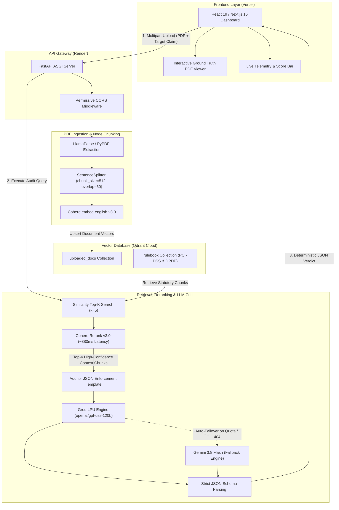

<div align="center">

# 🛡️ AuditRag

**Deterministic Enterprise Compliance Verification via Adversarial RAG**

[](https://audit-rag-dev.vercel.app/)

[](LICENSE)
[](https://www.python.org/)
[](https://fastapi.tiangolo.com/)
[](https://nextjs.org/)
[](https://www.llamaindex.ai/)
[](https://qdrant.tech/)

> "AuditRag automates enterprise document audits against strict compliance frameworks (PCI-DSS, DPDP Act), replacing manual review with deterministic, hallucination-free verification."

🚀 **Explore the Live Application:** **[https://audit-rag-dev.vercel.app/](https://audit-rag-dev.vercel.app/)**

[Live Demo](https://audit-rag-dev.vercel.app/) • [Architecture](#-architecture) • [Empirical Performance](#-empirical-benchmarks) • [Tech Stack](#-core-tech-stack) • [Getting Started](#-getting-started)

</div>

---

## 📌 Overview

> **Live Deployment:** The interactive platform is live on Vercel at **[https://audit-rag-dev.vercel.app/](https://audit-rag-dev.vercel.app/)**. Upload sample policies or select demo presets to run real-time compliance audits.

Enterprise legal, SecOps, and compliance teams spend countless hours auditing technical policy documents, architecture diagrams, and vendor agreements against rigid regulatory mandates. Traditional LLM-based solutions suffer from context window saturation, silent hallucinations, and non-deterministic rulings.

**AuditRag** is an adversarial compliance engine designed for Risk Officers, CISOs, and SecOps teams. It ingests complex enterprise policies, interrogates them against statutory rulebooks (e.g., **PCI-DSS v4.0.1** and the **Digital Personal Data Protection Act**), detects adversarial regulatory bypasses (such as prohibited plaintext CVV retention), and outputs strict, machine-readable JSON verdicts accompanied by exact section-level statutory citations.

---

## 📊 Empirical Benchmarks

AuditRag replaces subjective review with reproducible, measured RAG metrics:

| Metric | Manual Legal Audit | AuditRag Pipeline | Impact |
| :--- | :--- | :--- | :--- |
| **Review Latency** | 2.5 - 4.0 Hours | **~24.4 Seconds** | **>99% faster turnaround** from upload to audit report |
| **Context Compression** | N/A (Linear Reading) | **~380ms** (Cohere Rerank v3.0) | Filters out legal noise to top-4 high-density provisions |
| **Faithfulness Score** | Variable / Human Fatigue | **84.6% Grounded Citations** | Active pipeline iteration resolving extraction anomalies |

> **Note on Pipeline Reliability:** Grounded citation benchmarks reflect active hardening against multi-page PDF extraction anomalies, resolving the "Giant Chunk" blindspot using fine-grained `SentenceSplitter` configurations (`chunk_size=512`, `chunk_overlap=50`).

---

## 🏛 Architecture

AuditRag decouples presentation, document ingestion, vector retrieval, and LLM reasoning into an event-driven RAG architecture:



### End-to-End Workflow

1. **Document Ingestion**: Enterprise PDFs are uploaded via the Next.js UI, stripped of visual noise, and split into 512-token granular nodes to guarantee zero page truncation.
2. **Dense Vector Indexing**: Nodes are embedded through `Cohere embed-english-v3.0` and stored in isolated Qdrant Cloud collections (`uploaded_docs`).
3. **Target Claim Interrogation**: The user's compliance claim is mapped to statutory rule vectors (`rulebook` collection).
4. **Two-Stage Compression**: Vector similarity pulls candidate chunks, which are immediately compressed via `Cohere Rerank v3.0` (~380ms) down to the 4 most relevant statutory clauses.
5. **Adversarial Critic Evaluation**: The compressed context is fed into the LLM Critic Agent running on Groq LPU hardware (`openai/gpt-oss-120b`) with strict JSON schema enforcement. If primary LLM rate limits or timeouts occur, the pipeline automatically falls back to Gemini 3.8 Flash.
6. **Telemetry & Visual Grounding**: The frontend highlights non-compliant clauses in real-time alongside exact section coordinates in the embedded PDF viewer.

---

## 🛠 Core Tech Stack

| Domain | Technology | Purpose |
| :--- | :--- | :--- |
| **Frontend Framework** | **Next.js 16 (App Router)** | Server & Client components, static asset optimization |
| **UI & Styling** | **React 19, Tailwind CSS v4** | Modern dark-mode interface, Lucide icon suite |
| **PDF Rendering** | **react-pdf & jsPDF** | In-browser document visualizer & client-side plan export |
| **Backend Framework** | **FastAPI** | High-throughput async REST API with auto-generated OpenAPI docs |
| **Server Engine** | **Uvicorn** | Production ASGI server with multi-worker support |
| **RAG Orchestration** | **LlamaIndex Core (v0.14+)** | Ingestion pipelines, query engines, node splitters |
| **Vector Database** | **Qdrant Cloud** | Remote vector storage, payload metadata filtering |
| **Embeddings & Reranker** | **Cohere AI** | `embed-english-v3.0` and `cohere-rerank-v3.0` |
| **Primary LLM** | **Groq LPU (`openai/gpt-oss-120b`)** | Sub-second inference latency, strict JSON compliance |
| **Fallback LLM** | **Google Gemini (`gemini-3.8-flash`)** | Secondary enterprise fallback for 429 quota protection |
| **Document Parser** | **LlamaParse & PyPDF** | Complex layout preservation with resilient local fallback |

---

## ⚡ Key Features & Engineering Hurdles Solved

### 1. Dual-Engine LLM Redundancy (Groq + Gemini)
* **Problem:** Cloud LLM APIs regularly encounter strict TPM/RPM rate limits (HTTP 429) or unexpected model deprecations during heavy document audits.
* **Solution:** Built a dynamic fallback mechanism in `main.py` and `services/ai_pipeline.py`. High-speed Groq LPU inference (`openai/gpt-oss-120b` running at ~0.7s) serves as primary, with automatic failover to Google Gemini 3.8 Flash. Configurable at runtime via `GROQ_MODEL`.

### 2. Elimination of the "Giant Chunk" Blindspot
* **Problem:** Default LlamaIndex PDF ingestion treated multi-page documents as single oversized text blobs, causing embedding models to truncate text after 512 tokens and missing critical middle pages (e.g., hidden CVV retention rules).
* **Solution:** Explicitly integrated `SentenceSplitter(chunk_size=512, chunk_overlap=50)` inside the `IngestionPipeline`, ensuring a 4-page policy consistently splits into 15-25 searchable, discrete vector points.

### 3. Decoupled Production CORS Architecture
* **Problem:** Decoupled deployments across independent domains (Vercel for frontend, Render for backend) trigger browser CORS pre-flight blocks.
* **Solution:** Implemented hardened `CORSMiddleware` in FastAPI with explicit credential and method policies, enabling safe, non-blocking cross-origin transfers of multipart PDF streams and JSON payloads.

---

## 🚀 Getting Started

### Prerequisites
- Python 3.11 or 3.12
- Node.js 18.x or 20.x
- Remote Qdrant Cloud cluster
- API Keys: Groq, Cohere, LlamaCloud, and optionally Gemini

---

### 1. Repository Setup

```bash
git clone https://github.com/creativeprem789/AuditRAG.git
cd AuditRAG
```

---

### 2. Backend Setup

```bash
# Navigate to backend directory
cd backend

# Create and activate virtual environment
python -m venv venv
# On Windows:
.\venv\Scripts\activate
# On Linux/macOS:
source venv/bin/activate

# Install dependencies
pip install -r requirements.txt
```

Create a `.env` file inside the `backend/` directory:

```env
# Vector Database
QDRANT_URL="https://your-cluster-id.eu-central-1-0.aws.cloud.qdrant.io"
QDRANT_API_KEY="your-qdrant-api-key"

# AI & RAG APIs
COHERE_API_KEY="your-cohere-api-key"
LLAMA_CLOUD_API_KEY="your-llama-cloud-key"
GROQ_API_KEY="your-groq-api-key"
GEMINI_API_KEY="your-gemini-api-key"

# Optional Model Override (defaults to openai/gpt-oss-120b)
GROQ_MODEL="openai/gpt-oss-120b"
```

Start the FastAPI development server:

```bash
uvicorn main:app --reload --port 8000
```

Verify backend health at: [http://localhost:8000/ping](http://localhost:8000/ping) or open [http://localhost:8000/docs](http://localhost:8000/docs) for the interactive Swagger UI.

---

### 3. Frontend Setup

In a new terminal window:

```bash
# Navigate to frontend directory
cd frontend

# Install Node dependencies
npm install

# Create environment configuration
echo "NEXT_PUBLIC_BACKEND_URL=http://localhost:8000" > .env.local

# Run Next.js development server
npm run dev
```

Open [http://localhost:3000](http://localhost:3000) in your browser.

---

## 🗺 Future Roadmap

- [ ] **Multi-Regulation Expansion:** Ingest and index pre-built vectors for **GDPR**, **CCPA**, **HIPAA**, and **SOC 2 Type II**.
- [ ] **Automated Document Remediation:** Generate downloadable redlined document revisions with inline statutory corrections.
- [ ] **Multi-Modal Architecture Auditing:** Audit system network architecture diagrams (AWS / GCP / Azure topologies) directly against security frameworks.
- [ ] **Continuous CI/CD Compliance Gate:** Provide a GitHub Action to block PR merges if policy changes introduce statutory violations.

---

## 📄 License

Distributed under the **MIT License**. See [`LICENSE`](LICENSE) for more information.

---

<div align="center">
  <sub>Built with precision for enterprise regulatory assurance.</sub>
</div>
