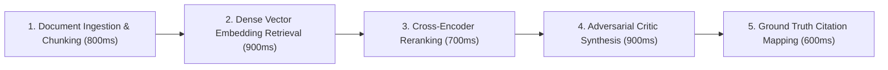
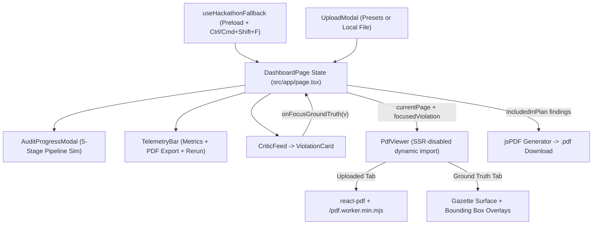

<div align="center">

# AuditRAG — Technical Playground

**Adversarial Regulatory Compliance Verification & Ground-Truth Citation Engine**

[](https://nextjs.org/)
[](https://react.dev/)
[](https://www.typescriptlang.org/)
[](https://tailwindcss.com/)
[](#built-in-demo-datasets)

*An interactive split-pane compliance cockpit for auditing enterprise policy documents against India's **Digital Personal Data Protection (DPDP) Act, 2023**—linking adversarial findings directly to ground-truth statutory coordinates and exportable remediation plans.*

[Features](#features) • [Architecture](#architecture--data-flow) • [Demo Walkthrough](#interactive-demo-walkthrough) • [Getting Started](#getting-started) • [Backend Integration](#backend-integration-guide) • [Project Structure](#project-structure)

</div>

---

## Overview

**AuditRAG** addresses a core problem in automated legal and compliance review: standard LLM summaries miss silent statutory gaps (*negative-space omissions*) and rarely prove *where* a policy conflicts with the law.

This frontend (`frontend` branch of `AuditRAG`) provides a dark-mode **Technical Playground** featuring:

- **Adversarial Critic Feed** classifying findings into `CRITICAL_VIOLATION`, `VIOLATION`, and `OMISSION`.
- **Synchronized Ground Truth Viewer** mapping each finding to exact page numbers, statutory sections, and coordinate bounding boxes.
- **One-Click Statutory Remediation Export** generating a formatted PDF Improvement Plan directly in the browser via `jsPDF`.
- **Zero-Backend Demo Resilience** with pre-calculated compliance presets, an offline PDF.js worker, and a `Ctrl+Shift+F` / `Cmd+Shift+F` instant recovery fallback.

> **Current Mode:** This workspace currently runs as a **self-contained, client-side playground** using pre-calculated JSON datasets, a simulated 5-stage RAG pipeline modal, live client-side PDF rendering (`react-pdf`), and browser-side PDF generation (`jsPDF`). See [Backend Integration Guide](#backend-integration-guide) for wiring it to live inference APIs.

---

## UI Layout Anatomy

```text
┌───────┬────────────────────────────────────────────────────────────────────────────────┐
│       │  AuditRAG [TECHNICAL PLAYGROUND]                                [?]  [🔔]  (U) │  Header (48px)
│       ├────────────────────────────────────────────────────────────────────────────────┤
│       │  ● FAITHFULNESS SCORE: 93.4%   REVIEW LATENCY: 4.2s   RERANKING: ~380ms        │  TelemetryBar
│       │                                [Download Improvement Plan (PDF)] [Rerun Audit] │  (40px)
│       ├──────────────────────────────────┬─────────────────────────────────────────────┤
│       │ ADVERSARIAL CRITIC FEED   [Upload]│ GROUND TRUTH REFERENCE VIEWER  [Tab Toggle] │
│  Nav  │ Target: Honey-Pot Data Policy    │ 📄 Honey-Pot_Data_Policy_2023.pdf           │
│ Rail  │                                  │ Page [4] 4 of 28  < >        [-] [+] 100%   │
│ (56px)│ ┌──────────────────────────────┐ │ ┌─────────────────────────────────────────┐ │
│       │ │ CRITICAL VIOLATION: ...    ▲ │ │ │         THE GAZETTE OF INDIA            │ │
│  •    │ │ Description + Fix + Citation │ │ │   DIGITAL PERSONAL DATA PROTECTION ACT  │ │
│  •    │ │          [Focus Ground Truth]│─┼─┼─ ─ ─ ─▶ ┌───────────────────────────┐   │ │
│  •    │ └──────────────────────────────┘ │ │         │ ⚠ CONTRADICTION FOUND #1 │   │ │
│  •    │ ┌──────────────────────────────┐ │ │         └───────────────────────────┘   │ │
│       │ │ VIOLATION: ...             ▼ │ │ │           (Pulsing Bounding Box)        │ │
│       │ └──────────────────────────────┘ │ └─────────────────────────────────────────┘ │
│       ├──────────────────────────────────┤                                             │
│  [→]  │ IMPROVEMENT PLAN  4 Fixes, ...   │                                             │
│       │                   [Download .PDF]│                                             │
└───────┴──────────────────────────────────┴─────────────────────────────────────────────┘
          Left Pane (45% width)              Right Pane (55% width)
```

---

## Features

### 1. Adversarial Critic Feed (Left Pane — 45%)
- **Severity-Coded Findings:** Distinct visual styling for `CRITICAL_VIOLATION` (rose), `VIOLATION` (muted rose), and `OMISSION` (amber).
- **Progressive Disclosure:** Finding #1 (`cv-001`) expands by default while remaining cards show compact single-line previews to keep the feed scannable.
- **Actionable Remediation & Citations:** Expanded cards show the policy conflict summary, a truncated `Fix:` remediation preview, the matched DPDP Act section (`sourceMatched`), and a **Focus Ground Truth** button.
- **Improvement Plan Footer Bar:** Tracks the count of included fixes and omissions ready for export (`ImprovementPlanBar`) with quick **Download .PDF** and dismiss actions.

### 2. Ground Truth Reference Viewer (Right Pane — 55%)
- **Dual-Mode Document Viewing:**
  - **Ground Truth View:** Renders a high-precision *Gazette of India — Digital Personal Data Protection Act, 2023* layout (including detailed Section 7, 8(3), and 9(1) statutory text on Page 4 and structured summary cards on other pages).
  - **Uploaded Doc View:** Uses `react-pdf` (`Document` + `Page`) with a locally hosted worker (`/pdf.worker.min.mjs`) to render user-uploaded PDFs offline via `URL.createObjectURL`.
- **Synchronized Bounding Boxes & Bezier Connector:**
  - Selecting a card or clicking **Focus Ground Truth** jumps to `violation.pageNumber`, smoothly scrolls the page into view, and highlights matching regions with pulsing dashed overlays (`violation-bbox`) and coordinate tooltips (`Exact coordinate: ...`).
  - On `xl` viewports, displays an SVG dashed Bezier connector linking Card #1 directly to Page 4 in the Ground Truth view.
- **Interactive Controls:** Direct numeric page jump, previous/next page arrows, and `60%`–`180%` zoom scaling.

### 3. Simulated 5-Stage Adversarial RAG Pipeline
Clicking **Rerun Audit** or loading a new preset/document opens `AuditProgressModal`, stepping through the audit lifecycle (~3.9s total):



### 4. Client-Side Statutory Improvement Plan Export (`jsPDF`)
Clicking **Download Improvement Plan (PDF)** or **Download .PDF** generates `AuditRAG_Improvement_Plan_<document>.pdf` in-browser containing:
- Branded dark header with target document and ground-truth corpus metadata.
- Telemetry summary strip (`Faithfulness Score`, `Review Latency`, generation date).
- Multi-page paginated finding blocks with severity badges, descriptions, highlighted `STATUTORY REMEDIATION CLAUSE` boxes, and exact page/coordinate citations.

### 5. Hackathon Fallback Mode (`Ctrl+Shift+F` / `Cmd+Shift+F`)
- Automatically pre-loads `HONEY_POT_FALLBACK_JSON` on initial render so the playground is immediately interactive.
- Pressing **`Ctrl+Shift+F`** (Windows/Linux) or **`Cmd+Shift+F`** (macOS) via `useHackathonFallback` resets the workspace to the default DPDP Act ground-truth dataset and flashes an emerald confirmation overlay (`1.2s`).

---

## Architecture & Data Flow



---

## Built-In Demo Datasets

Defined in `src/data/honeyPotFallback.ts`:

| Preset Key | Target Document | Findings | Faithfulness | Review / Rerank Latency | Covered DPDP Act Sections |
| --- | --- | --- | --- | --- | --- |
| `honey-pot` *(default)* | `Honey-Pot_Data_Policy_2023.pdf` | **5** (1 Critical, 2 Violations, 2 Omissions) | `93.4%` | `4.2s` / `~380ms` | Sec. 8(3), Sec. 8(6), Sec. 10(1), Sec. 6(1), Sec. 13(1) |
| `fintech-lending` | `NeoPay_Lending_Terms_2024.pdf` | **3** (1 Critical, 1 Violation, 1 Omission) | `88.2%` | `3.7s` / `~290ms` | Sec. 7(b), Sec. 8(6), Sec. 9(1) |

<details>
<summary><strong>Inspect Finding Breakdown for Both Presets</strong></summary>

**1. `Honey-Pot_Data_Policy_2023.pdf`**
- `#1 CRITICAL_VIOLATION` — **Indefinite Data Retention** (`DPDP Act Sec. 8(3)`, Page 4, coord `#95`)
- `#2 VIOLATION` — **Bypassing Breach SLA** (`DPDP Act Sec. 8(6)`, Page 6, coord `#142`)
- `#3 OMISSION` — **No Data Protection Officer** (`DPDP Act Sec. 10(1)`, Page 8, coord `#210`)
- `#4 VIOLATION` — **Consent Dark Patterns** (`DPDP Act Sec. 6(1)`, Page 3, coord `#78`)
- `#5 OMISSION` — **No Grievance Redressal Mechanism** (`DPDP Act Sec. 13(1)`, Page 12, coord `#305`)

**2. `NeoPay_Lending_Terms_2024.pdf`**
- `#1 CRITICAL_VIOLATION` — **Unrestricted Credit Bureau Data Reselling** (`DPDP Act Sec. 7(b)`, Page 4, coord `#104`)
- `#2 VIOLATION` — **Force Majeure Breach Notification Waiver** (`DPDP Act Sec. 8(6)`, Page 6, coord `#155`)
- `#3 OMISSION` — **No Minor Consent Verification Mechanism** (`DPDP Act Sec. 9(1)`, Page 8, coord `#188`)

</details>

---

## Interactive Demo Walkthrough

1. **Launch the Playground:** Open `http://localhost:3000`. The `Honey-Pot_Data_Policy_2023.pdf` audit is pre-loaded with Card #1 focused on Page 4 of the DPDP Act Gazette view.
2. **Navigate Violations:** Click any card in the **Adversarial Critic Feed** or click **Focus Ground Truth** to jump the right pane to that finding's page and bounding box.
3. **Switch Presets or Upload a PDF:** Click **Upload / Change PDF** in the feed header:
   - Choose **`NeoPay_Lending_Terms_2024.pdf`** to inspect the FinTech preset, or
   - Drag and drop a local `.pdf` file to render it live in the **Uploaded Doc** tab with overlaid bounding boxes on Page 1.
4. **Rerun the Pipeline:** Click **Rerun Audit** in the telemetry bar to replay the 5-stage progress modal.
5. **Export Remediation Plan:** Click **Download Improvement Plan (PDF)** (top bar) or **Download .PDF** (bottom bar) to save a multi-section remediation PDF.
6. **Instant Reset:** Press `Ctrl+Shift+F` (or `Cmd+Shift+F` on macOS) at any time to restore the default fallback state.

---

## Tech Stack & Key Configuration

| Component | Version / Details | Why It's Configured This Way |
| --- | --- | --- |
| **Next.js** | `^16.4.5` (App Router) | `dev` and `build` run with `--webpack` so `next.config.ts` can alias `canvas: false` for `react-pdf`. |
| **React** | `^19.3.1` | Powers client components (`"use client"`). |
| **TypeScript** | `^7.0.2` (`strict: true`) | Path alias `@/*` maps to `./src/*`. |
| **Tailwind CSS** | `^4.3.5` via `@tailwindcss/postcss` | Imported via `@import "tailwindcss";` in `globals.css` with custom keyframe animations. |
| **react-pdf** | `^11.0.0` | Dynamically imported with `ssr: false`; loads `/pdf.worker.min.mjs` from `public/` for offline reliability. |
| **jsPDF** | `^4.2.1` | Generates styled multi-page PDF remediation reports purely client-side. |
| **lucide-react** | `^1.70.0` | UI iconography across headers, cards, modals, and toolbars. |

Notable configuration details in `next.config.ts` and `src/app/globals.css`:
- `devIndicators: false` + CSS rules (`nextjs-portal`, `#__next-build-watcher`, `[data-nextjs-toast]`) suppress the Next.js dev overlay corner indicator for clean demo presentation.
- `.react-pdf__Page__textContent` and `.react-pdf__Page__annotations` are hidden (matching `renderTextLayer={false}` / `renderAnnotationLayer={false}`) so uploaded PDFs render as crisp canvases beneath bounding-box overlays.

---

## Getting Started

### Prerequisites

- **Node.js** `18.18+` or `20+`
- **npm** (lockfile: `package-lock.json`)

### Local Setup

```bash
# 1. Install dependencies
npm install

# 2. Start the Webpack-based Next.js dev server
npm run dev
```

Open [http://localhost:3000](http://localhost:3000) in your browser.

### Scripts (`package.json`)

| Script | Command | Description |
| --- | --- | --- |
| `npm run dev` | `next dev --webpack` | Starts the local development server with Webpack enabled |
| `npm run build` | `next build --webpack` | Creates an optimized production build |
| `npm run start` | `next start` | Serves the production build |
| `npm run lint` | `next lint` | Invokes Next.js linting *(install ESLint packages first if needed)* |

---

## Project Structure

```text
AuditRag_frontend/
├── public/
│   ├── DPDP_Act_2023_Official.pdf     # Official DPDP Act 2023 PDF bundled as static asset
│   └── pdf.worker.min.mjs             # Local PDF.js worker for offline react-pdf rendering
├── src/
│   ├── app/
│   │   ├── globals.css                # Dark palette tokens, scrollbars, PDF & pulse animations
│   │   ├── layout.tsx                 # Root HTML shell, dark mode class, Inter & JetBrains Mono fonts
│   │   └── page.tsx                   # Split-pane dashboard state, Bezier overlay, jsPDF export
│   ├── components/
│   │   ├── AuditProgressModal.tsx     # 5-stage animated adversarial RAG pipeline modal
│   │   ├── CriticFeed.tsx             # Left-pane findings feed, upload trigger, empty state
│   │   ├── Header.tsx                 # Top bar ("AuditRAG" + "Technical Playground" badge)
│   │   ├── ImprovementPlanBar.tsx     # Bottom remediation summary bar & PDF download trigger
│   │   ├── PdfViewer.tsx              # Ground Truth Gazette & react-pdf uploaded PDF viewer
│   │   ├── Sidebar.tsx                # 56px left navigation rail
│   │   ├── TelemetryBar.tsx           # Faithfulness/latency badges + Export/Rerun buttons
│   │   ├── UploadModal.tsx            # Drag-and-drop file modal + demo preset switcher
│   │   └── ViolationCard.tsx          # Expandable severity card with fix preview & Focus action
│   ├── data/
│   │   └── honeyPotFallback.ts        # AuditReportJSON / ViolationItem types + demo datasets
│   └── hooks/
│       └── useHackathonFallback.ts    # Default preload + Ctrl/Cmd+Shift+F instant reset hook
├── empty-module.js                    # Empty CommonJS stub module
├── next.config.ts                     # Disables devIndicators; aliases `canvas: false` in webpack
├── package.json                       # Package metadata (`autorag`), dependencies, webpack scripts
├── postcss.config.mjs                 # Tailwind CSS v4 PostCSS config
└── tsconfig.json                      # Strict TypeScript configuration (`@/*` -> `./src/*`)
```

---

## Backend Integration Guide

### Expected API Response Contract

Any backend audit endpoint connected to this UI should return JSON conforming to `AuditReportJSON` (`src/data/honeyPotFallback.ts`):

```ts
export interface ViolationItem {
  id: string;
  cardNumber: number;
  type: "CRITICAL_VIOLATION" | "VIOLATION" | "OMISSION";
  title: string;
  description: string;
  suggestedRevision: string;
  sourceMatched: string;
  pageNumber: number;
  coordinates: {
    label: string;
    exactCoord: number;
    topPct: number;
    leftPct: number;
    widthPct: number;
    heightPct: number;
  };
  includedInPlan: boolean;
}

export interface AuditReportJSON {
  targetDocumentName: string;
  groundTruthPdfName: string;
  totalPages: number;
  telemetry: {
    faithfulnessScore: string;
    reviewLatency: string;
    rerankingLatency: string;
  };
  findings: ViolationItem[];
}
```

<details>
<summary><strong>Example JSON Payload & Integration Touchpoints</strong></summary>

```json
{
  "targetDocumentName": "Privacy_Policy_v2.pdf",
  "groundTruthPdfName": "DPDP_Act_2023_Official.pdf",
  "totalPages": 14,
  "telemetry": {
    "faithfulnessScore": "94.1%",
    "reviewLatency": "3.4s",
    "rerankingLatency": "~310ms"
  },
  "findings": [
    {
      "id": "cv-001",
      "cardNumber": 1,
      "type": "CRITICAL_VIOLATION",
      "title": "INDEFINITE DATA RETENTION",
      "description": "Policy allows indefinite log retention, contradicting DPDP Act Section 8.",
      "suggestedRevision": "\"All personal data shall be deleted or anonymized within 30 days of account termination.\"",
      "sourceMatched": "DPDP Act Sec. 8(3)",
      "pageNumber": 4,
      "coordinates": {
        "label": "Indefinite Data Retention",
        "exactCoord": 95,
        "topPct": 37,
        "leftPct": 7,
        "widthPct": 86,
        "heightPct": 20
      },
      "includedInPlan": true
    }
  ]
}
```

**Where to plug in live backend calls:**
1. **`src/components/UploadModal.tsx` (`handleStartAudit`):** Replace the mock Page 1 findings generator for `uploadedFile` with a `multipart/form-data` `POST` request returning `AuditReportJSON`.
2. **`src/components/AuditProgressModal.tsx`:** Replace fixed `setTimeout` stage durations with Server-Sent Events (SSE) or WebSocket progress events from the backend pipeline.
3. **`src/components/ViolationCard.tsx`:** Wire a checkbox/toggle button to the already-passed `onTogglePlan(violation.id)` prop if per-finding export filtering is desired in the UI.
4. **`src/components/Sidebar.tsx` & `src/components/Header.tsx`:** Attach Next.js `<Link>` routes or modal handlers to the currently static navigation rail (`Overview`, `Playground`, `Frameworks`, `Integrations`) and header utility icons.

</details>

---

## Known Demo Limitations

- **Custom Upload Analysis is Simulated:** Uploading a local PDF renders your real PDF pages inside `PdfViewer`, while `UploadModal` generates 3 sample Page 1 findings (`up-001`, `up-002`, `up-003`) for live bounding-box demonstration. Note that while the file picker accepts `.pdf`, `.doc`, `.docx`, and `.txt`, only `.pdf` files are rendered by `react-pdf`.
- **Ground Truth Tab Rendering:** The **Ground Truth** tab displays an HTML/Tailwind representation of the *Gazette of India* (with Section 7, 8(3), and 9(1) statutory copy on Page 4 and dynamic finding summaries on other pages), while `public/DPDP_Act_2023_Official.pdf` is bundled in `public/`.
- **Plan Toggle UI Hidden:** `handleTogglePlan` in `src/app/page.tsx` and `includedInPlan` filtering in `ImprovementPlanBar` / `jsPDF` export are implemented, though `ViolationCard` intentionally omits a toggle checkbox to keep cards minimal.
- **Static Chrome Controls:** `Sidebar` navigation items and `Header` icons (`HelpCircle`, `Bell`) are visual placeholders.
